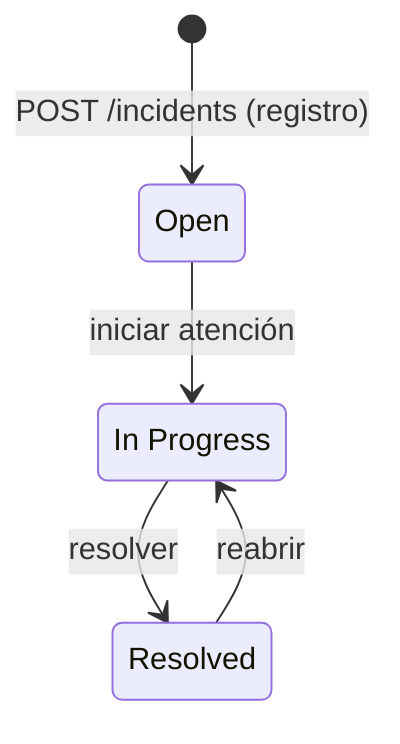

# DG-001: Estados de la incidencia

**Tipo:** Estados

Ciclo de vida del campo `status` de la incidencia ([MD-001](../models/MD-001-incidencia.md)): estado inicial y transiciones permitidas por [`PATCH /incidents/{id}/status`](../apis/API-001-incidencias.md#patch-incidents-id-status) ([US-005](../../../specs/changes/user-stories/US-005-cambiar-estado-incidencia/README.md)). No cubre la UI (acciones visibles) ni historial de cambios, que está fuera de alcance.

## Diagrama

## Notas

- **Valores literales:** `Open`, `In Progress` y `Resolved`, tal como viajan en el contrato (decisión del usuario: no se normalizan). En el diagrama, `InProgress` es solo el identificador interno de Mermaid del estado `In Progress`.
- **Estado inicial:** toda incidencia nace en `Open` al registrarse ([`POST /incidents`](../apis/API-001-incidencias.md#post-incidents), [FL-001](../flows/FL-001-registro-incidencia.md)); no hay estado final: `Resolved` puede reabrirse.
- **Transiciones permitidas** (BR-01 de US-005) — tabla de referencia para la validación del backend y para las acciones que ofrece el detalle (AC-007):

  | Estado actual | Destinos permitidos | Acción en la UI |
  | ------------- | ------------------- | --------------- |
  | `Open` | `In Progress` | Iniciar atención |
  | `In Progress` | `Resolved` | Resolver |
  | `Resolved` | `In Progress` | Reabrir |

- **Transiciones rechazadas:** cualquier otra, incluida la que mantiene el mismo estado (`Open → Open`) y los saltos `Open → Resolved` y `Resolved → Open`; responden `409` sin modificar la incidencia (BR-02 de US-005). El recorrido completo está en [FL-005](../flows/FL-005-cambio-estado-incidencia.md).
