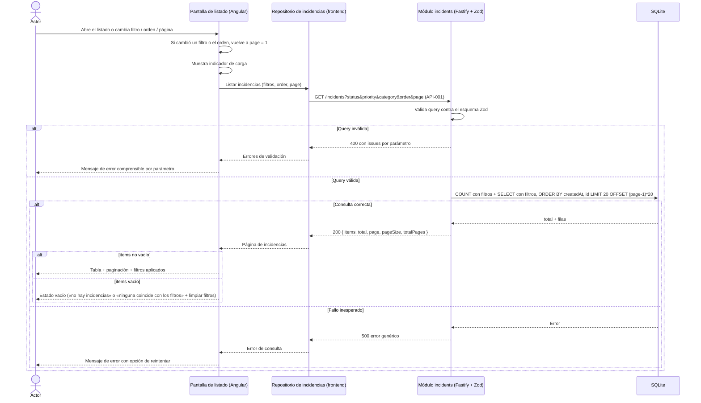

# FL-002: Consulta del listado de incidencias

**Disparador:** el actor abre el listado de incidencias en `helpdesk-frontend`, o cambia un filtro, el orden o la página.
**Actores / componentes:** Agente de soporte o empleado; pantalla de listado (Angular); repositorio de incidencias del frontend (patrón Repository REST); módulo `incidents` de `helpdesk-backend` (ruta Fastify + esquema Zod + servicio); SQLite.
**Resultado:** la pantalla muestra la página solicitada con las incidencias que cumplen los filtros, el total, la página actual y el número de páginas; o un estado vacío, o un error con opción de reintentar.

Recorrido de RF-02 / [US-002](../../../specs/changes/user-stories/US-002-listar-filtrar-incidencias/README.md): traducción de los controles de la pantalla a la consulta [`GET /incidents`](../apis/API-001-incidencias.md#get-incidents), validación, consulta paginada y presentación. Fuera: el detalle ([FL-003](FL-003-consulta-detalle-incidencia.md)), que se abre al seleccionar una fila.

## Flujo

## Pasos

1. El **actor** abre el listado o modifica un filtro (estado, prioridad, categoría), el orden o la página.
2. La **pantalla de listado** vuelve a la página 1 cuando cambia un filtro o el orden (AC-007 de US-002), muestra el indicador de carga y pide al **repositorio** la página con los filtros activos; los filtros sin valor no se envían.
3. El **repositorio** envía [`GET /incidents`](../apis/API-001-incidencias.md#get-incidents) con `status`, `priority`, `category`, `order` y `page` (codificando `In Progress` en la URL), conforme al contrato OpenAPI.
4. La **ruta Fastify** valida la query con el esquema Zod; si algún parámetro es inválido, el manejador común responde `400` con un `issue` por parámetro y mensaje propio en español (AC-006).
5. El **servicio del módulo** cuenta las incidencias que cumplen todos los filtros y recupera la página: orden por `createdAt` (y por `id` como desempate) en el sentido de `order`, 20 elementos, desplazamiento `(page - 1) × 20`.
6. El **backend** responde `200` con `items`, `total`, `page`, `pageSize = 20` y `totalPages`; una página fuera de rango devuelve `items: []` (AC-005).
7. La **pantalla** retira el indicador de carga y muestra identificador, título, categoría, prioridad, estado y fecha de creación de cada incidencia, con acceso a su detalle ([FL-003](FL-003-consulta-detalle-incidencia.md)), la paginación y los filtros aplicados con la acción de limpiarlos.
8. Si `items` está vacío, la **pantalla** muestra el estado vacío que corresponde: sin filtros y `total = 0` → «no hay incidencias registradas»; con filtros → «ninguna incidencia coincide con los filtros» con la acción de limpiar filtros (AC-008).

## Manejo de errores

| Paso | Error posible | Comportamiento esperado |
| ---- | ------------- | ----------------------- |
| 4 | Parámetro de filtro, orden o página inválido | `400` con `issues` por parámetro; la pantalla presenta los motivos devueltos por la API (AC-010); en uso normal no ocurre porque los controles solo ofrecen valores válidos |
| 5 | Fallo inesperado de la base de datos | `500` con error genérico; la pantalla muestra un mensaje comprensible con opción de reintentar (AC-009) |
| 3 | Backend no disponible o error de red | Mismo comportamiento que el `500` |
| 6 | Página fuera de rango (p. ej. tras reducirse el total) | No es error: `200` con `items: []`; la pantalla muestra el estado vacío con los totales reales |

## Notas

- **Solo lectura e idempotente:** repetir la consulta no altera datos; el reintento es seguro.
- **Consistencia entre `total` y `items`:** el recuento y la página se obtienen en dos sentencias de lectura; en una aplicación de demostración con SQLite local se acepta que un registro concurrente entre ambas pueda desfasar `total` en una unidad.
- **Valores de estado:** se muestran literales (`Open`, `In Progress`, `Resolved`); categoría y prioridad con las etiquetas de [WF-001](../../../specs/changes/user-stories/US-001-registrar-incidencia/wireframes/WF-001-registro-incidencia.md) ([MD-001](../models/MD-001-incidencia.md)).
- **Estado de filtros en la URL del frontend** (para compartir o recargar la vista): no lo exige US-002; se decide en la planificación técnica o con el wireframe del listado.
