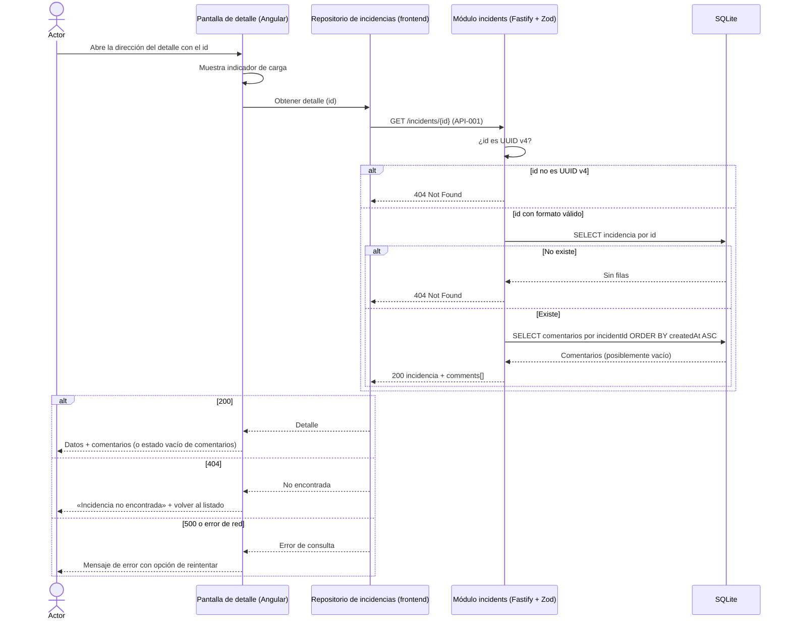

# FL-003: Consulta del detalle de una incidencia

**Disparador:** el actor abre el detalle de una incidencia desde el listado o accede directamente a su dirección propia en `helpdesk-frontend`.
**Actores / componentes:** Agente de soporte o empleado; pantalla de detalle (Angular); repositorio de incidencias del frontend; módulo `incidents` de `helpdesk-backend`; SQLite.
**Resultado:** la pantalla muestra todos los datos de la incidencia y sus comentarios en orden cronológico ascendente; o el mensaje «incidencia no encontrada» con acceso al listado; o un error con opción de reintentar.

Recorrido de RF-03 / [US-003](../../../specs/changes/user-stories/US-003-detalle-incidencia/README.md) sobre [`GET /incidents/{id}`](../apis/API-001-incidencias.md#get-incidents-id). La pantalla de detalle es además el punto de partida de [FL-004](FL-004-registro-comentario.md) (agregar comentario) y [FL-005](FL-005-cambio-estado-incidencia.md) (cambiar estado), que no se describen aquí.

## Flujo

## Pasos

1. El **actor** abre el detalle desde una fila del listado ([FL-002](FL-002-consulta-listado-incidencias.md)) o directamente por su dirección propia, que contiene el `id` (AC-005 de US-003).
2. La **pantalla de detalle** muestra el indicador de carga y pide el detalle al **repositorio**, que envía [`GET /incidents/{id}`](../apis/API-001-incidencias.md#get-incidents-id).
3. El **servicio del módulo** comprueba que el `id` tiene formato UUID v4; si no lo tiene, responde `404` sin consultar la base de datos — mismo cuerpo que una incidencia inexistente (BR-01 de US-003).
4. El **servicio** busca la incidencia ([MD-001](../models/MD-001-incidencia.md)); si no existe responde `404`.
5. El **servicio** recupera sus comentarios ([MD-002](../models/MD-002-comentario.md)) ordenados por `createdAt` ascendente (desempate por orden de inserción) y responde `200` con la incidencia y `comments` (`[]` si no hay).
6. La **pantalla** muestra identificador, título, descripción, categoría, prioridad, estado y fecha de creación, y la lista de comentarios con contenido, autor y fecha; si no hay comentarios, un estado vacío comprensible (AC-002, AC-003, AC-007).

## Manejo de errores

| Paso | Error posible | Comportamiento esperado |
| ---- | ------------- | ----------------------- |
| 3 | `id` que no es UUID v4 | `404` con el error de recurso no encontrado; la pantalla muestra «incidencia no encontrada» con acción para volver al listado (AC-006) |
| 4 | Incidencia inexistente | Igual que el anterior; indistinguible para el cliente |
| 4–5 | Fallo inesperado de la base de datos | `500` con error genérico; mensaje comprensible con opción de reintentar (AC-007) |
| 2 | Backend no disponible o error de red | Mismo comportamiento que el `500` |

## Notas

- **Solo lectura e idempotente:** el reintento es seguro.
- **Lecturas:** incidencia y comentarios se leen en dos consultas (o una con `JOIN`); la elección se hace en la planificación técnica.
- **Dirección propia del detalle en el frontend:** la ruta exacta de Angular (p. ej. por `id`) se fija en la planificación técnica o con el wireframe del detalle (ver Observaciones del [README de la capability](../README.md)).
