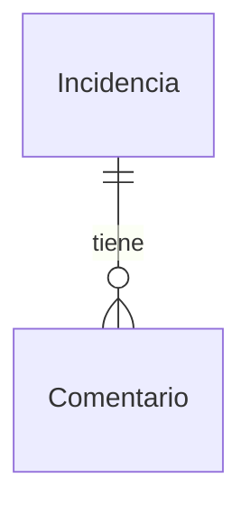

# MD-001: Incidencia

Entidad persistida (SQLite, [ADR-007](../../../../helpdesk-backend/docs/adr/ADR-007-sqlite-persistencia-local.md)) que representa una solicitud de soporte interno registrada por un empleado. Es también la forma con la que la API la devuelve en el contrato OpenAPI compartido ([ADR-008](../../../../helpdesk-backend/docs/adr/ADR-008-contrato-openapi-fuente-compartida.md)). Los campos `id`, `status` y `createdAt` los asigna el sistema; el solicitante solo aporta `title`, `description`, `category` y `priority`.

## Campos

| Campo | Tipo | Requerido | Descripción | Validaciones / restricciones |
| ----- | ---- | --------- | ----------- | ---------------------------- |
| id | string (UUID v4) | Sí | Identificador único de la incidencia | Generado por el sistema al crear; único; inmutable; nunca aportado por el cliente |
| title | string | Sí | Título breve de la solicitud | Se recorta (trim) antes de validar; longitud 5–100 caracteres tras el recorte; un valor solo con espacios cuenta como vacío |
| description | string | Sí | Descripción detallada del problema | Se recorta (trim) antes de validar; longitud 10–2000 caracteres tras el recorte; un valor solo con espacios cuenta como vacío |
| category | enum `IncidentCategory` | Sí | Categoría funcional de la incidencia | `HARDWARE` \| `SOFTWARE` \| `ACCESS_PERMISSIONS` \| `NETWORK_CONNECTIVITY` \| `EMAIL_COMMUNICATION` \| `OTHER` |
| priority | enum `IncidentPriority` | Sí | Prioridad indicada por el solicitante | `LOW` \| `MEDIUM` \| `HIGH` (equivalencia con Baja/Media/Alta en Notas) |
| status | enum `IncidentStatus` | Sí | Estado del ciclo de vida | `Open` \| `In Progress` \| `Resolved` (literales, con espacio en `In Progress`); al crear SIEMPRE `Open`; nunca aportado al crear; solo cambia por las transiciones de [DG-001](../diagrams/DG-001-estados-incidencia.md) vía [`PATCH /incidents/{id}/status`](../apis/API-001-incidencias.md#patch-incidents-id-status) |
| createdAt | string (date-time ISO 8601, UTC) | Sí | Fecha y hora de registro | Asignada por el sistema al persistir; inmutable |

## Relaciones de Incidencia

- 1—N `Comentario` ([MD-002](MD-002-comentario.md)) vía `incidentId` del comentario — una incidencia tiene cero o más comentarios; no existe borrado de incidencias ni de comentarios, por lo que no aplica cascada. Los comentarios no son un campo persistido de la incidencia: se adjuntan, ordenados, solo en la respuesta de detalle ([`GET /incidents/{id}`](../apis/API-001-incidencias.md#get-incidents-id)).

## Notas

- **Equivalencia de prioridad:** el contrato usa códigos y la UI muestra etiquetas. `LOW` ↔ Baja · `MEDIUM` ↔ Media · `HIGH` ↔ Alta. Las etiquetas visibles de categoría y prioridad son las del wireframe aprobado [WF-001](../../../specs/changes/user-stories/US-001-registrar-incidencia/wireframes/WF-001-registro-incidencia.md).
- **Espacios en blanco:** `title` y `description` se recortan (trim) antes de aplicar las validaciones de longitud, de modo que un valor compuesto solo por espacios equivale a vacío y se rechaza (AC-004, AC-005).
- **Valores de `status`:** se mantienen literales en el contrato (`Open`, `In Progress`, `Resolved`), sin normalizar al estilo `UPPER_SNAKE` de `category` y `priority` — decisión confirmada por el usuario ([US-005](../../../specs/changes/user-stories/US-005-cambiar-estado-incidencia/README.md)). En un query string, `In Progress` viaja codificado (`In%20Progress` o `In+Progress`).
- **Ciclo de vida de `status`:** nace en `Open` y solo cambia por las transiciones `Open → In Progress`, `In Progress → Resolved` y `Resolved → In Progress`; cualquier otra, incluida la del mismo estado, se rechaza sin modificar la incidencia. Diagrama y tabla de transiciones en [DG-001](../diagrams/DG-001-estados-incidencia.md). El resto de campos es inmutable tras la creación (no hay edición de incidencias).
- **Representaciones en la API:** el listado ([`GET /incidents`](../apis/API-001-incidencias.md#get-incidents)), la creación y el cambio de estado devuelven la incidencia con los campos de esta tabla; el detalle ([`GET /incidents/{id}`](../apis/API-001-incidencias.md#get-incidents-id)) añade además `comments`: [MD-002](MD-002-comentario.md)[]. Los indicadores del dashboard son la proyección [MD-003](MD-003-indicadores-incidencias.md).
- **Índices sugeridos:** el listado filtra por `status`, `priority` y `category` y ordena por `createdAt`; los índices concretos se deciden en la planificación técnica junto con la librería de acceso a datos.
- **Origen del dato:** `id`, `status` y `createdAt` los asigna el backend (BR-01 de [US-001](../../../specs/changes/user-stories/US-001-registrar-incidencia/README.md)). Una solicitud inválida no produce ningún registro (BR-04, RNF-03); la creación es una sola inserción atómica, por lo que no exige transacción explícita según el estándar de persistencia del backend ([persistence.md](../../../../helpdesk-backend/docs/standards/persistence.md)).
- **Fuera de alcance de este modelo:** fechas de actualización/resolución e historial de cambios de estado (fuera de alcance de [US-003](../../../specs/changes/user-stories/US-003-detalle-incidencia/README.md) y US-005), autor o solicitante (no hay autenticación real), adjuntos.
- **Pendientes** (detalle en Observaciones del [README de la capability](../README.md)): nombres de tabla/columnas y representación de `createdAt` en SQLite (se deciden en la planificación técnica junto con la librería de acceso a datos).

## Historial de cambios

| Fecha | Cambio | Origen |
| ----- | ------ | ------ |
| 2026-10-12 | `status`: valores literales confirmados (sin normalizar) y transiciones definidas en [DG-001](../diagrams/DG-001-estados-incidencia.md); se cierra el pendiente de estilo de `status` | [US-005](../../../specs/changes/user-stories/US-005-cambiar-estado-incidencia/README.md) |
| 2026-10-12 | Añadida la relación 1—N con [MD-002](MD-002-comentario.md) (comentarios) y la representación de detalle con `comments` | [US-003](../../../specs/changes/user-stories/US-003-detalle-incidencia/README.md), [US-004](../../../specs/changes/user-stories/US-004-comentar-incidencia/README.md) |
| 2026-10-12 | Notas sobre las representaciones en listado e indicadores ([MD-003](MD-003-indicadores-incidencias.md)) | [US-002](../../../specs/changes/user-stories/US-002-listar-filtrar-incidencias/README.md), [US-006](../../../specs/changes/user-stories/US-006-dashboard-indicadores/README.md) |
