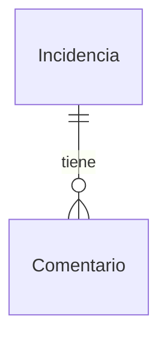

# MD-002: Comentario

Entidad persistida (SQLite, [ADR-007](../../../../helpdesk-backend/docs/adr/ADR-007-sqlite-persistencia-local.md)) que registra una nota de seguimiento sobre una incidencia ([MD-001](MD-001-incidencia.md)). Es también la forma con la que la API devuelve cada comentario, tanto al crearlo como dentro del detalle de la incidencia. El cliente solo aporta `content`; `id`, `incidentId`, `author` y `createdAt` los asigna el sistema. Los comentarios no se editan ni se eliminan.

## Campos

| Campo | Tipo | Requerido | Descripción | Validaciones / restricciones |
| ----- | ---- | --------- | ----------- | ---------------------------- |
| id | string (UUID v4) | Sí | Identificador único del comentario | Generado por el sistema al crear; único; inmutable; nunca aportado por el cliente |
| incidentId | string (UUID v4) | Sí | Incidencia a la que pertenece ([MD-001](MD-001-incidencia.md)); N comentarios por incidencia | Tomado del parámetro de ruta `{id}` de [`POST /incidents/{id}/comments`](../apis/API-001-incidencias.md#post-incidents-id-comments); debe corresponder a una incidencia existente; inmutable; nunca aportado en el body |
| content | string | Sí | Texto del comentario | Se recorta (trim) antes de validar; longitud 1–500 caracteres tras el recorte; un valor solo con espacios cuenta como vacío; se guarda el valor recortado |
| author | string | Sí | Autor del comentario | Siempre el usuario de demostración fijo, asignado por el sistema; nunca aportado por el cliente (valor literal `Agente demo`) |
| createdAt | string (date-time ISO 8601, UTC) | Sí | Fecha y hora de registro del comentario | Asignada por el sistema al persistir; inmutable |

## Relaciones de Comentario

- N—1 `Incidencia` ([MD-001](MD-001-incidencia.md)) vía `incidentId`, obligatoria — clave foránea hacia la incidencia; no existe borrado de incidencias ni de comentarios, por lo que no aplica cascada.

## Notas

- **Origen del dato:** `id`, `author` y `createdAt` los asigna el backend; el body de creación es **estricto** y rechaza con `400`, sin persistir, cualquier clave no declarada, incluidos `id`, `createdAt` y `author` (BR-01 y AC-002 de [US-004](../../../specs/changes/user-stories/US-004-comentar-incidencia/README.md)).
- **Autor:** no hay autenticación; el autor es un usuario de demostración predefinido, el mismo para todos los comentarios. Su valor literal (nombre visible) es `Agente demo`, fijado en el wireframe aprobado del formulario de comentario de US-004.
- **Orden:** los comentarios de una incidencia se presentan por `createdAt` ascendente (del más antiguo al más reciente); ante igualdad de `createdAt` se desempata por orden de inserción para que el orden sea estable (BR-02 de [US-003](../../../specs/changes/user-stories/US-003-detalle-incidencia/README.md), AC-006 de US-004).
- **Ciclo de vida:** inmutable una vez creado; no se exponen operaciones de edición ni de eliminación (BR-03 y AC-007 de US-004).
- **Persistencia:** la creación es una única inserción atómica; no exige transacción explícita ([persistence.md](../../../../helpdesk-backend/docs/standards/persistence.md)). Nombres de tabla/columnas e índice por `incidentId` se deciden en la planificación técnica.
