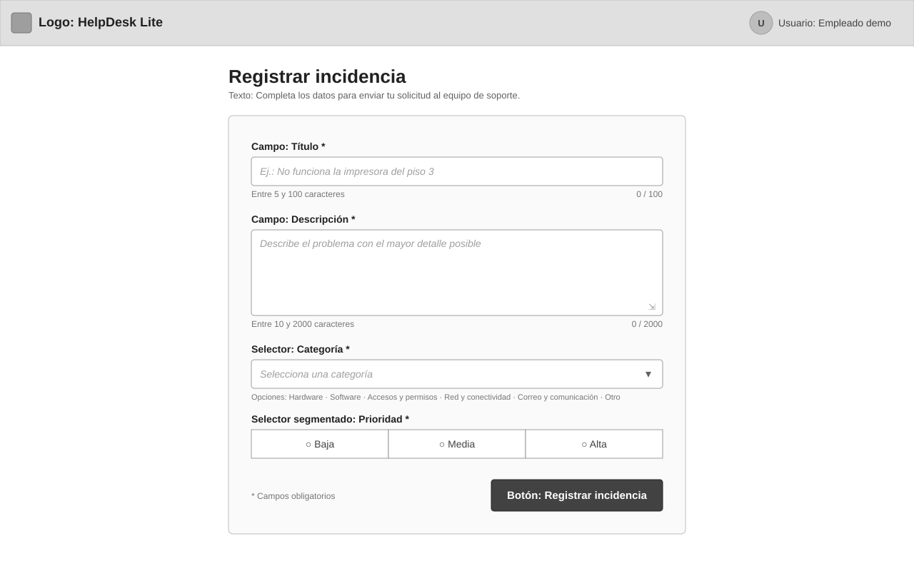
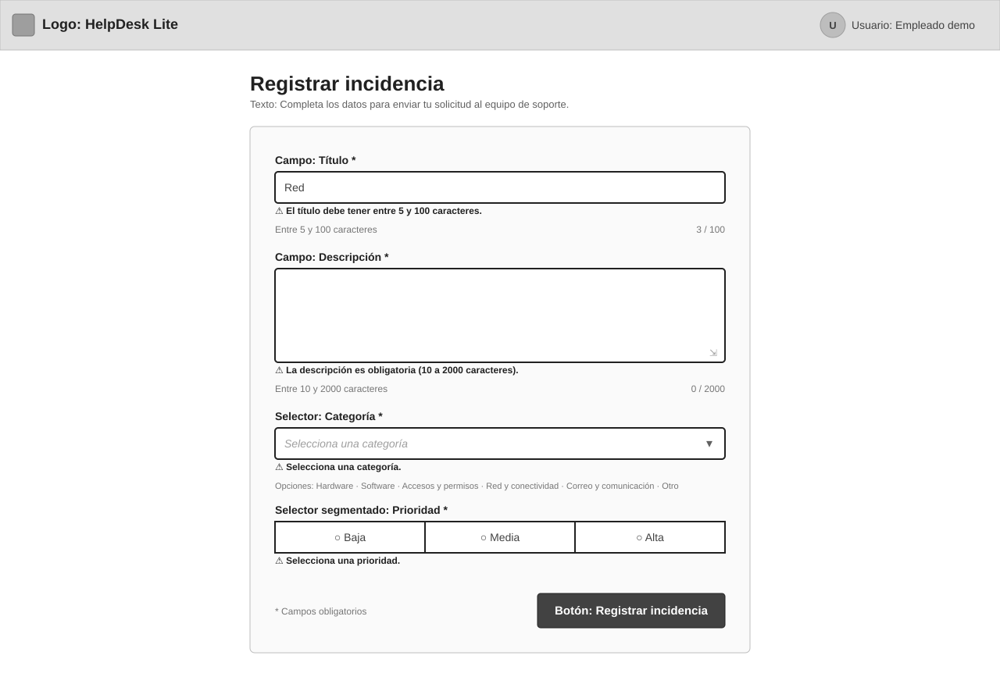
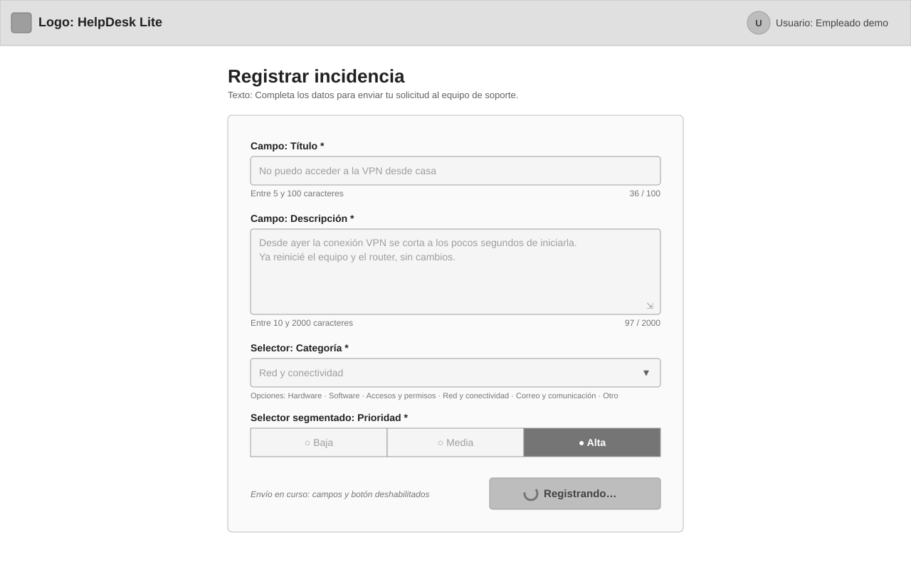
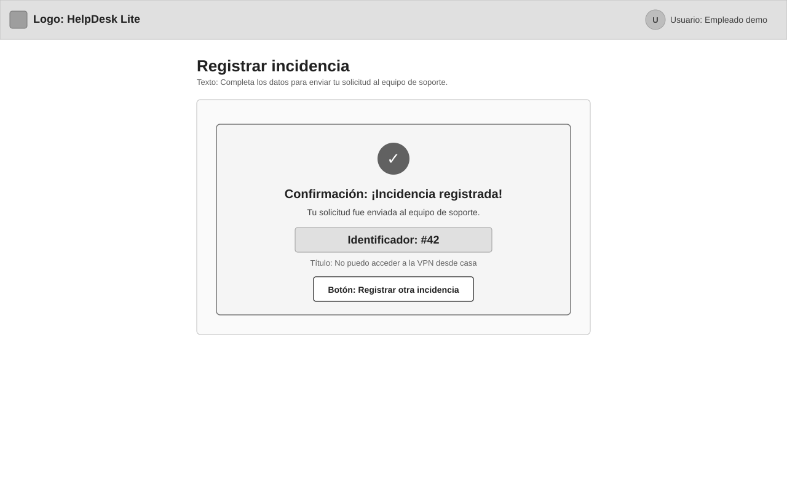
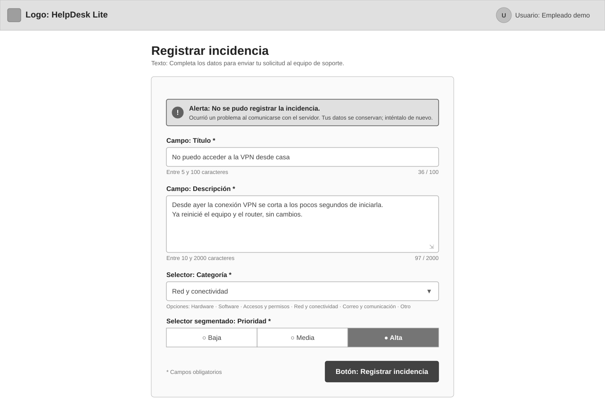
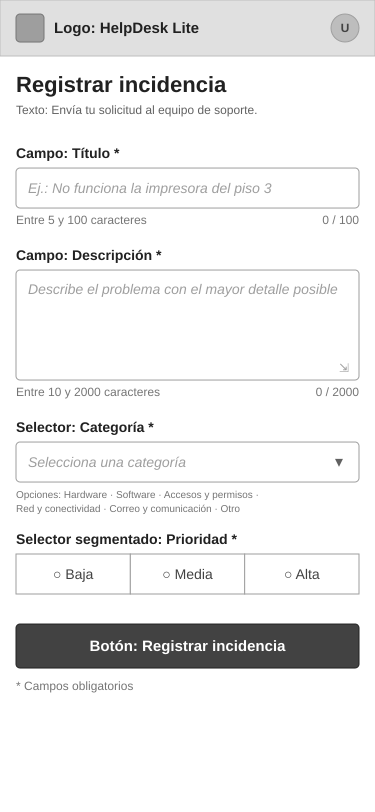

# WF-001: Registro de incidencia

Permite al empleado solicitante registrar una solicitud de soporte indicando título, descripción, categoría y prioridad (AC-001). Al enviarla ve un indicador de carga y, si tiene éxito, una confirmación con el identificador asignado (AC-002, AC-009); si hay datos inválidos ve el error junto a cada campo (AC-004 a AC-008, AC-010), y si el registro falla, un mensaje de error general (AC-009).

## Wireframe

## Componentes

- Encabezado: logo/nombre «HelpDesk Lite» y el usuario predefinido de la demo («Empleado demo»); sin autenticación real.
- Título de página «Registrar incidencia» y texto introductorio breve.
- Campo «Título» (obligatorio, una línea): ayuda «Entre 5 y 100 caracteres» y contador `n / 100` (AC-004).
- Campo «Descripción» (obligatorio, multilínea redimensionable): ayuda «Entre 10 y 2000 caracteres» y contador `n / 2000` (AC-005).
- Selector «Categoría» (obligatorio, lista desplegable sin valor preseleccionado) con etiquetas legibles en español: Hardware (`HARDWARE`), Software (`SOFTWARE`), Accesos y permisos (`ACCESS_PERMISSIONS`), Red y conectividad (`NETWORK_CONNECTIVITY`), Correo y comunicación (`EMAIL_COMMUNICATION`), Otro (`OTHER`) (AC-006, BR-03).
- Selector segmentado «Prioridad» (obligatorio, selección única sin valor preseleccionado): Baja, Media, Alta (AC-006, BR-03).
- Botón primario «Registrar incidencia»: valida el formulario; si hay errores los muestra junto a cada campo y no envía (AC-008); si es válido, envía la solicitud (AC-001, AC-010).
- Leyenda «* Campos obligatorios».

## Estados

- Errores de validación: cada campo inválido se resalta con borde marcado y muestra debajo su mensaje; la solicitud no se envía. Los errores por campo devueltos por la API se presentan del mismo modo (AC-004 a AC-008, AC-010) — [WF-001-registro-incidencia-errores.svg](./WF-001-registro-incidencia-errores.svg)

  

- Enviando: el botón muestra un indicador de carga y el texto «Registrando…»; campos y botón quedan deshabilitados para evitar envíos duplicados (AC-009) — [WF-001-registro-incidencia-enviando.svg](./WF-001-registro-incidencia-enviando.svg)

  

- Éxito: el formulario se sustituye por una confirmación «¡Incidencia registrada!» con el identificador asignado destacado y el título como referencia; el botón «Registrar otra incidencia» vuelve al formulario vacío (AC-002, AC-009) — [WF-001-registro-incidencia-exito.svg](./WF-001-registro-incidencia-exito.svg)

  

- Error general de la API: alerta sobre el formulario «No se pudo registrar la incidencia» con un motivo comprensible; los datos ingresados se conservan y el botón vuelve a estar habilitado para reintentar (AC-009) — [WF-001-registro-incidencia-error-api.svg](./WF-001-registro-incidencia-error-api.svg)

  

- Vista móvil (responsiva): una sola columna a ancho completo, encabezado compacto con el usuario como avatar y botón de envío a ancho completo; mismos campos y estados — [WF-001-registro-incidencia-movil.svg](./WF-001-registro-incidencia-movil.svg)

  

## Notas

- Los textos son de ejemplo. El identificador mostrado (`#42`) es un placeholder visual: el contrato fija el `id` como UUID v4 ([MD-001](../../../../../architecture/incidencias/models/MD-001-incidencia.md)), que es el valor que muestra la confirmación ([ADR-008](../../../../../../helpdesk-backend/docs/adr/ADR-008-contrato-openapi-fuente-compartida.md)).
- Validación en el cliente al pulsar «Registrar incidencia» (y por campo al salir de él); el botón no se deshabilita por errores: al pulsarlo se muestran todos los errores pendientes y no se envía la solicitud. Decisión de UX confirmada en la revisión.
- Mientras se envía, el formulario completo (campos y botón) queda bloqueado para evitar envíos duplicados; si la API falla, los datos ingresados se conservan para reintentar. Decisiones de UX confirmadas en la revisión.
- Contadores de caracteres `n / 100` (Título) y `n / 2000` (Descripción) confirmados en la revisión. Las etiquetas en español de categoría y prioridad son las de este wireframe; los códigos enviados a la API son los del contrato ([MD-001](../../../../../architecture/incidencias/models/MD-001-incidencia.md)): prioridad `LOW` | `MEDIUM` | `HIGH` ↔ Baja | Media | Alta.
- La pantalla no enlaza al listado ni al detalle de la incidencia: pertenecen a otras historias (fuera de alcance de US-001).

## Historial de cambios

| Fecha | Observación del usuario | Resuelto en |
| ----- | ------------------------- | ------------ |
| 2026-10-12 | Aprobado sin cambios en el SVG, junto con las propuestas de UX: el botón de envío no se deshabilita con errores (los muestra todos y no envía), formulario bloqueado mientras se envía, datos conservados si la API falla, contadores de caracteres `n / 100` y `n / 2000` | Estado → Approved; Notas actualizadas (propuestas pasan a confirmadas; `#42` aclarado como placeholder del UUID v4 que fija el contrato). Sin impacto en `AC-XXX` |
