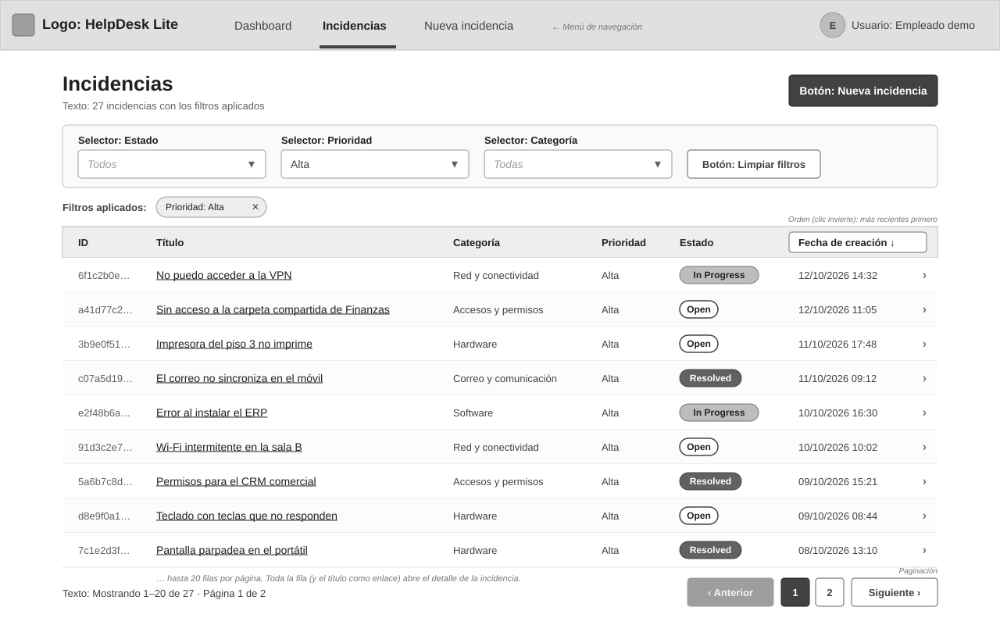
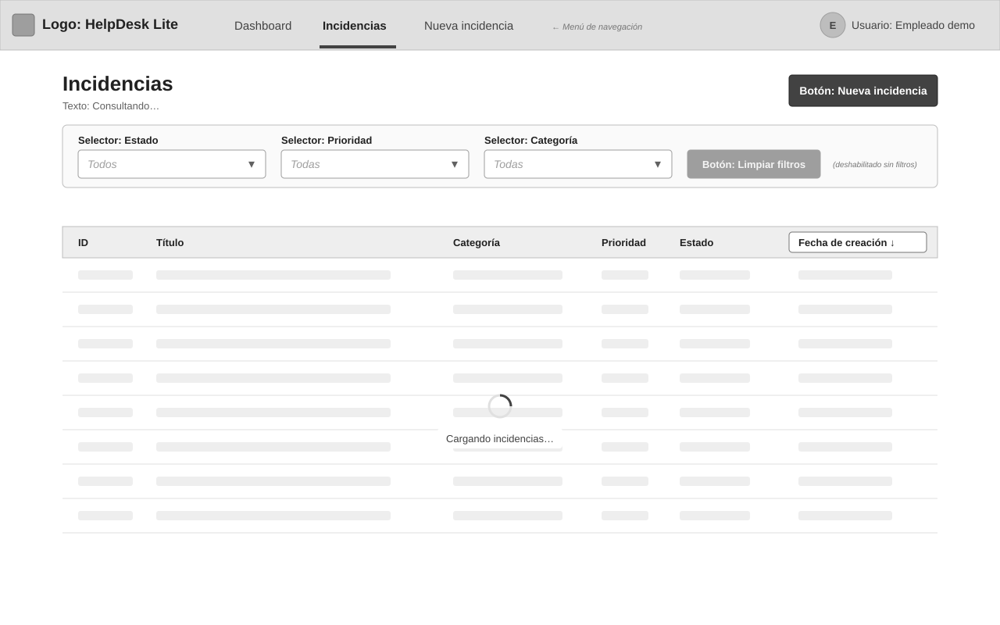
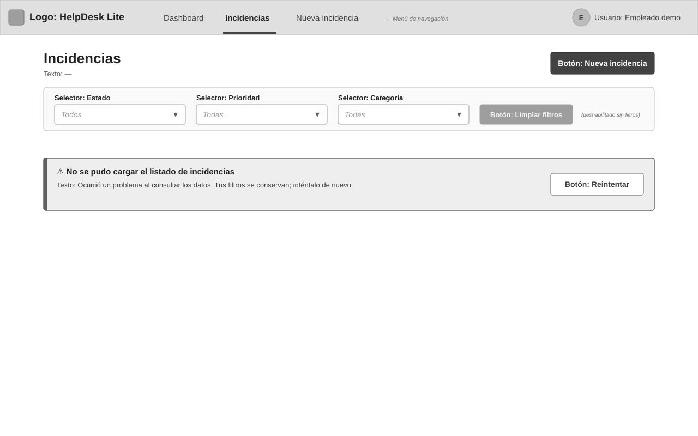
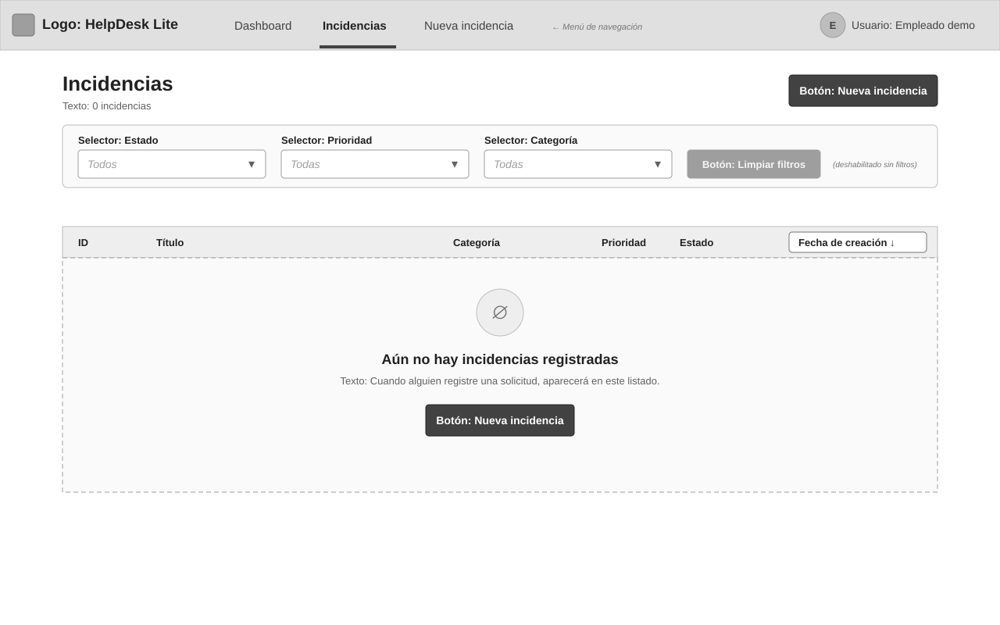
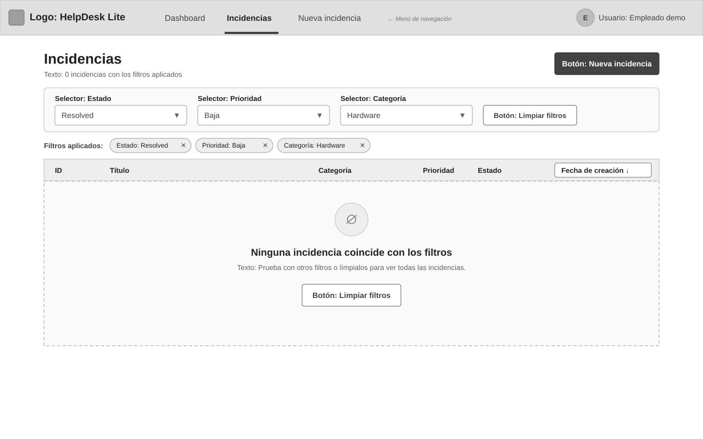
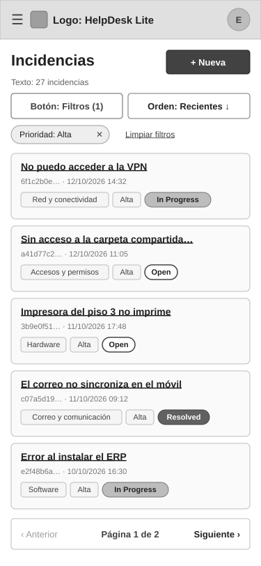

# WF-001: Listado de incidencias

Permite al agente (o al empleado) consultar las incidencias registradas en una tabla con id, título, categoría, prioridad, estado y fecha de creación, y abrir el detalle de cada una (AC-001, AC-002). Puede filtrar por estado, prioridad y categoría, ver y limpiar los filtros aplicados, invertir el orden por fecha y paginar de 20 en 20 (AC-003 a AC-005, AC-007). Distingue «no hay incidencias» de «ninguna coincide con los filtros» y muestra carga y error con reintentar (AC-008, AC-009).

## Wireframe

## Componentes

- Encabezado común con menú de navegación (sección «Incidencias» activa) y usuario «Empleado demo».
- Título «Incidencias», número de resultados con los filtros actuales y botón primario «Nueva incidencia» (abre el registro de US-001).
- Barra de filtros (AC-003): tres selectores de un solo valor — «Estado» (Todos · `Open` · `In Progress` · `Resolved`), «Prioridad» (Todas · Baja · Media · Alta) y «Categoría» (Todas · Hardware · Software · Accesos y permisos · Red y conectividad · Correo y comunicación · Otro) — y el botón «Limpiar filtros», deshabilitado cuando no hay ninguno aplicado (AC-007).
- Filtros aplicados: una etiqueta por filtro activo («Prioridad: Alta ✕»); la ✕ quita solo ese filtro (AC-007).
- Tabla (AC-002): columnas ID (8 primeros caracteres del id), Título (enlace), Categoría, Prioridad, Estado (etiqueta con el valor literal `Open` / `In Progress` / `Resolved`) y Fecha de creación (`dd/mm/aaaa hh:mm`). Toda la fila abre el detalle de la incidencia ([WF-001 de US-003](../../US-003-detalle-incidencia/wireframes/WF-001-detalle-incidencia.md)).
- Orden (AC-004): el encabezado «Fecha de creación ↓» es un botón; por defecto más recientes primero (↓) y al pulsarlo se invierte (↑).
- Paginación (AC-005): «Mostrando 1–20 de 27 · Página 1 de 2», «‹ Anterior», números de página y «Siguiente ›»; «Anterior» deshabilitado en la primera página y «Siguiente» en la última.

## Estados

- Cargando: la tabla muestra filas de marcador gris y «Cargando incidencias…»; filtros visibles; sin paginación (AC-009) — [WF-001-listado-incidencias-cargando.svg](./WF-001-listado-incidencias-cargando.svg)

  

- Error: alerta «No se pudo cargar el listado de incidencias» con motivo comprensible y botón «Reintentar»; los filtros se conservan (AC-009). Si la API devuelve un error de validación (p. ej. una dirección con un filtro inválido), la alerta lista cada parámetro y su motivo en español y ofrece «Limpiar filtros» (AC-010) — [WF-001-listado-incidencias-error.svg](./WF-001-listado-incidencias-error.svg)

  

- Sin incidencias (no hay ninguna registrada y no hay filtros): «Aún no hay incidencias registradas» con el botón «Nueva incidencia» (AC-008) — [WF-001-listado-incidencias-vacio.svg](./WF-001-listado-incidencias-vacio.svg)

  

- Sin coincidencias (hay filtros aplicados y ningún resultado): «Ninguna incidencia coincide con los filtros» con el botón «Limpiar filtros» (AC-008) — [WF-001-listado-incidencias-sin-coincidencias.svg](./WF-001-listado-incidencias-sin-coincidencias.svg)

  

- Vista móvil (responsiva): la tabla se sustituye por tarjetas (título como enlace, id abreviado y fecha, etiquetas de categoría, prioridad y estado); los filtros se abren con el botón «Filtros (n)», el orden con «Orden: Recientes ↓», y la paginación se reduce a «‹ Anterior · Página x de y · Siguiente ›» — [WF-001-listado-incidencias-movil.svg](./WF-001-listado-incidencias-movil.svg)

  

## Notas

- Datos de ejemplo. Contrato: `GET /incidents` ([API-001](../../../../../architecture/incidencias/apis/API-001-incidencias.md#get-incidents)) con `status`, `priority`, `category`, `order` y `page`; la página de 20 y los totales (`total`, `page`, `totalPages`) alimentan el texto de paginación (AC-010).
- Etiquetas de categoría y prioridad: las de [WF-001 de US-001](../../US-001-registrar-incidencia/wireframes/WF-001-registro-incidencia.md) (prioridad `LOW` | `MEDIUM` | `HIGH` ↔ Baja | Media | Alta); los estados se muestran literales.
- Cada filtro admite **un solo valor** (selector simple), coherente con el contrato actual; la selección múltiple no está contemplada (cierra la observación abierta en el [README de la capability](../../../../../architecture/incidencias/README.md) si se aprueba así).
- Al cambiar un filtro o el orden se vuelve a la página 1 (AC-007). Propuesta: los filtros, el orden y la página se reflejan en la dirección de la página, de modo que recargar o volver atrás conserva la vista.
- Propuesta: el id se muestra abreviado (8 primeros caracteres) en la tabla y completo en el detalle.

## Historial de cambios

| Fecha | Observación del usuario | Resuelto en |
| ----- | ------------------------- | ------------ |
| 2026-10-12 | Aprobado tal cual en la revisión del lote | — |
