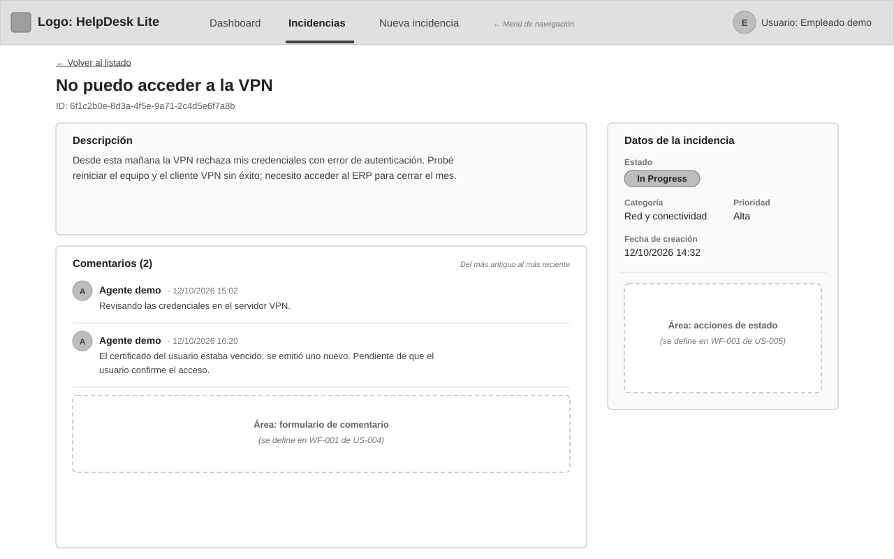
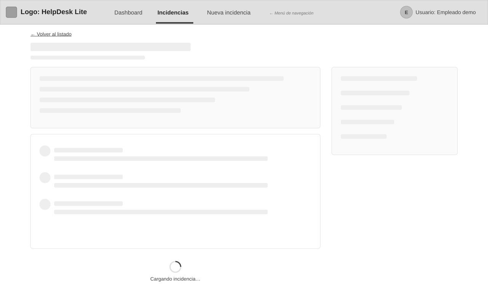
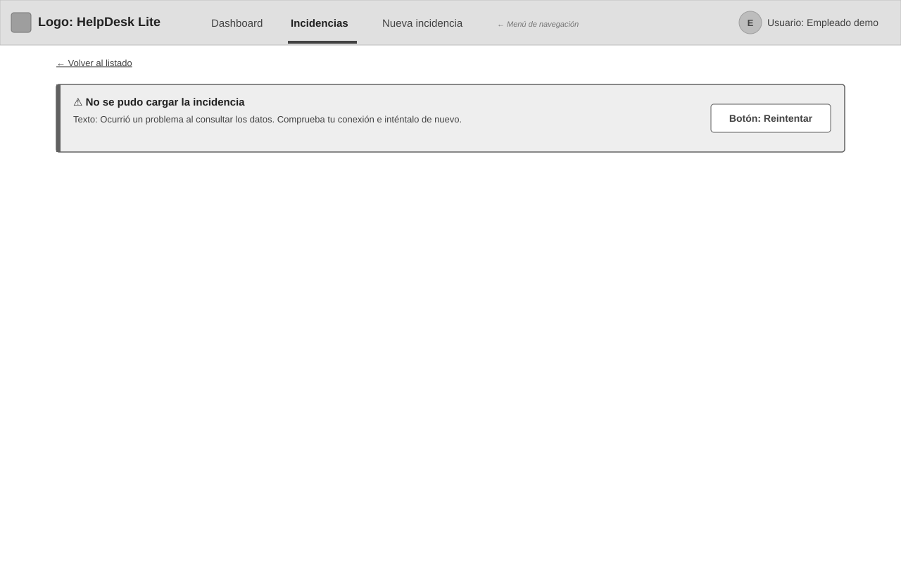
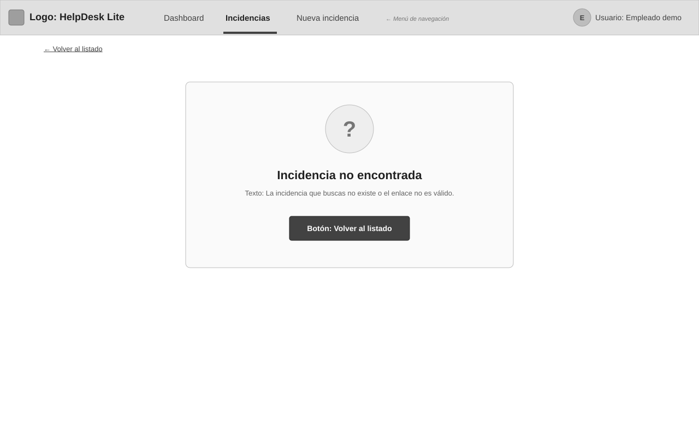
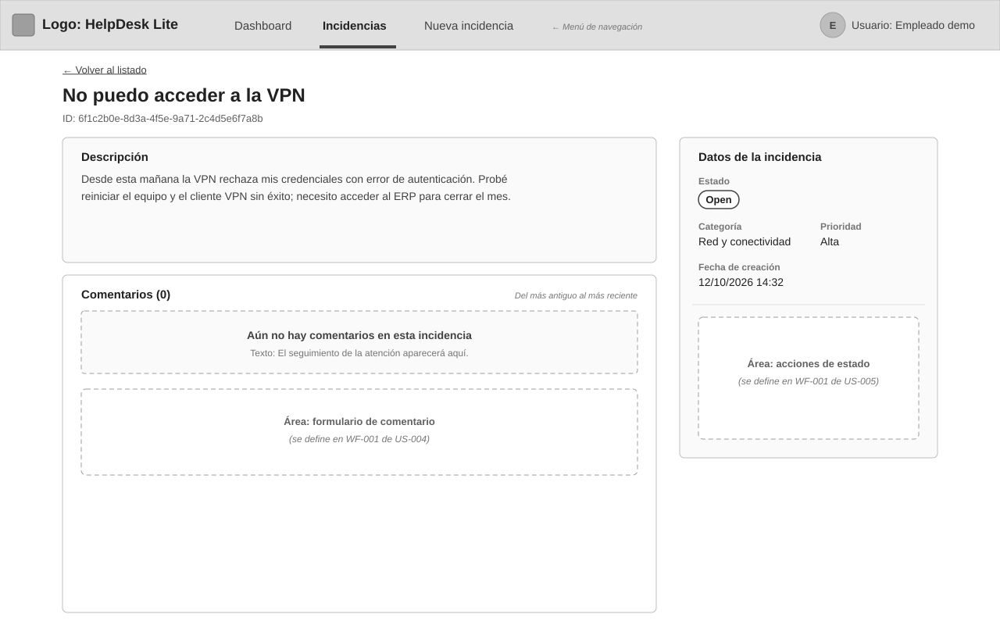
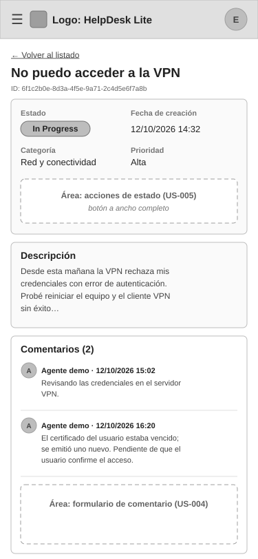

# WF-001: Detalle de incidencia

Muestra una incidencia en su propia dirección, abierta desde el listado o por su id (AC-001, AC-005): título, id, descripción, estado, categoría, prioridad, fecha de creación y sus comentarios del más antiguo al más reciente (AC-002, AC-003). Incluye carga, error con reintentar, «aún no hay comentarios» (AC-007) y «incidencia no encontrada» con vuelta al listado (AC-006). Las áreas punteadas reservan el formulario de comentario (US-004) y las acciones de estado (US-005).

## Wireframe

## Componentes

- Encabezado común con menú de navegación (sección «Incidencias» activa) y usuario «Empleado demo».
- Enlace «← Volver al listado».
- Título de la incidencia y su id completo.
- Tarjeta «Descripción» con el texto completo (respeta saltos de línea).
- Panel lateral «Datos de la incidencia»: Estado (etiqueta literal `Open` / `In Progress` / `Resolved`), Categoría y Prioridad (etiquetas en español de [WF-001 de US-001](../../US-001-registrar-incidencia/wireframes/WF-001-registro-incidencia.md)) y Fecha de creación (`dd/mm/aaaa hh:mm`).
- Área reservada «Acciones de estado» en el panel lateral — definida en [WF-001 de US-005](../../US-005-cambiar-estado-incidencia/wireframes/WF-001-acciones-estado.md).
- Tarjeta «Comentarios (n)»: cada comentario con avatar, autor, fecha y contenido, en orden cronológico ascendente (AC-003); debajo de la lista, el área reservada del formulario — definida en [WF-001 de US-004](../../US-004-comentar-incidencia/wireframes/WF-001-formulario-comentario.md).

## Estados

- Cargando: bloques grises en lugar del título, la descripción, los datos y los comentarios, con «Cargando incidencia…» (AC-007) — [WF-001-detalle-incidencia-cargando.svg](./WF-001-detalle-incidencia-cargando.svg)

  

- Error: alerta «No se pudo cargar la incidencia» con motivo comprensible y botón «Reintentar»; el enlace «Volver al listado» sigue visible (AC-007) — [WF-001-detalle-incidencia-error.svg](./WF-001-detalle-incidencia-error.svg)

  

- Incidencia no encontrada (id inexistente o inválido): mensaje «Incidencia no encontrada» con texto explicativo y botón «Volver al listado» (AC-006) — [WF-001-detalle-incidencia-no-encontrada.svg](./WF-001-detalle-incidencia-no-encontrada.svg)

  

- Sin comentarios: «Comentarios (0)» con el mensaje «Aún no hay comentarios en esta incidencia» (AC-007) — [WF-001-detalle-incidencia-sin-comentarios.svg](./WF-001-detalle-incidencia-sin-comentarios.svg)

  

- Vista móvil (responsiva): una sola columna — datos de la incidencia en cuadrícula de 2 × 2 con las acciones de estado debajo (botón a ancho completo), descripción, comentarios y formulario — [WF-001-detalle-incidencia-movil.svg](./WF-001-detalle-incidencia-movil.svg)

  

## Notas

- Datos de ejemplo. Contrato: `GET /incidents/{id}` ([API-001](../../../../../architecture/incidencias/apis/API-001-incidencias.md#get-incidents-id)) devuelve la incidencia ([MD-001](../../../../../architecture/incidencias/models/MD-001-incidencia.md)) con `comments` ([MD-002](../../../../../architecture/incidencias/models/MD-002-comentario.md)) ordenados ascendentemente; el `404` se presenta como «Incidencia no encontrada» (AC-008).
- El autor de los comentarios es el usuario de demostración del sistema; su nombre visible («Agente demo») lo fija [WF-001 de US-004](../../US-004-comentar-incidencia/wireframes/WF-001-formulario-comentario.md).
- Propuesta: la dirección del detalle es `/incidents/{id}`; la ruta exacta de Angular se confirma en la planificación técnica ([FL-003](../../../../../architecture/incidencias/flows/FL-003-consulta-detalle-incidencia.md)).
- Propuesta: el formulario de comentario va **debajo** de la lista, junto al comentario más reciente, porque el orden es ascendente.

## Historial de cambios

| Fecha | Observación del usuario | Resuelto en |
| ----- | ------------------------- | ------------ |
| 2026-10-12 | Aprobado tal cual en la revisión del lote | — |
