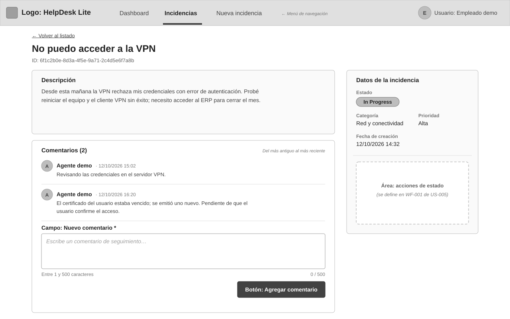
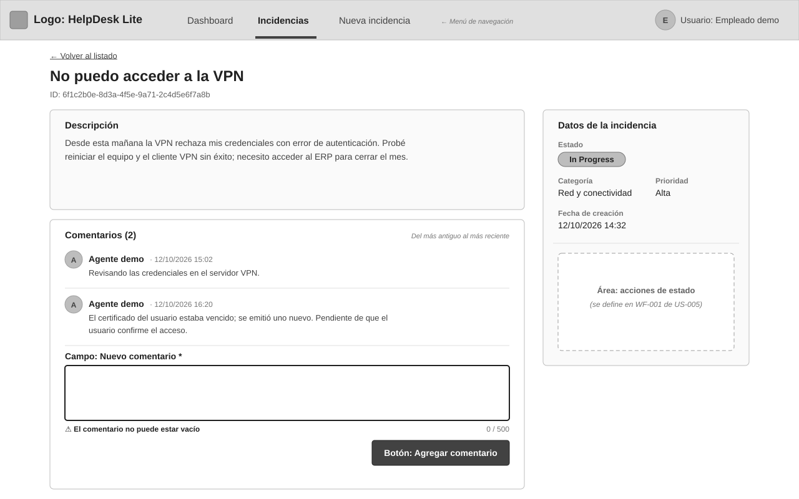
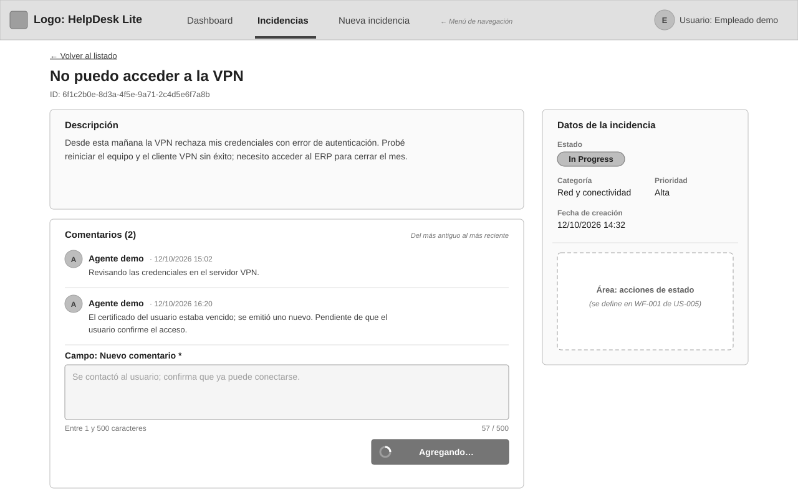
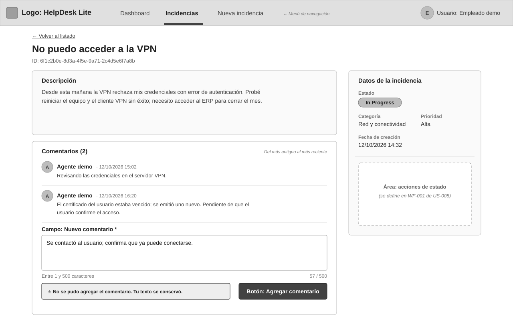
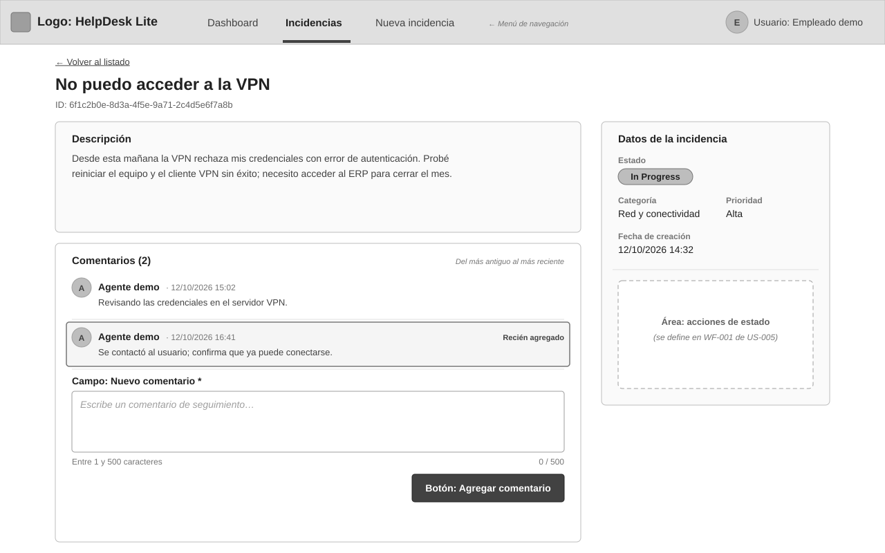

# WF-001: Formulario de comentario

Dentro del detalle de la incidencia, el agente escribe un comentario de seguimiento y lo agrega (AC-001); ve un contador `n / 500` y el error junto al campo si el contenido es inválido, sin enviar (AC-003, AC-008). Al enviar ve un indicador de carga con el formulario bloqueado; si falla, un error comprensible conservando el texto (AC-009); si tiene éxito, el comentario aparece al final de la lista, con autor «Agente demo» y fecha, y el campo queda vacío (AC-002, AC-006, AC-008).

## Wireframe

## Componentes

- Pantalla de detalle de [WF-001 de US-003](../../US-003-detalle-incidencia/wireframes/WF-001-detalle-incidencia.md); esta pantalla define solo la tarjeta «Comentarios».
- Lista de comentarios: avatar, autor «Agente demo», fecha (`dd/mm/aaaa hh:mm`) y contenido, del más antiguo al más reciente (AC-006). Sin acciones de editar ni eliminar (AC-007).
- Campo «Nuevo comentario» (obligatorio, multilínea) debajo de la lista, con ayuda «Entre 1 y 500 caracteres» y contador `n / 500` (AC-003, AC-008).
- Botón primario «Agregar comentario»: valida y, si el contenido es válido, envía; si no, muestra el error junto al campo y no envía (AC-008).

## Estados

- Error de validación: campo resaltado y mensaje debajo («El comentario no puede estar vacío» o «El comentario no puede superar los 500 caracteres»); no se envía. Los errores por campo devueltos por la API se presentan igual (AC-003, AC-004, AC-010) — [WF-001-formulario-comentario-errores.svg](./WF-001-formulario-comentario-errores.svg)

  

- Enviando: el botón muestra un indicador y «Agregando…»; campo y botón bloqueados para evitar envíos duplicados (AC-009) — [WF-001-formulario-comentario-enviando.svg](./WF-001-formulario-comentario-enviando.svg)

  

- Error de envío: aviso «No se pudo agregar el comentario» junto al botón; el texto escrito se conserva y el formulario vuelve a estar habilitado para reintentar (AC-009) — [WF-001-formulario-comentario-error-envio.svg](./WF-001-formulario-comentario-error-envio.svg)

  

- Comentario agregado: el nuevo comentario aparece al final de la lista, destacado brevemente como «Recién agregado», el contador de la tarjeta aumenta y el campo queda vacío, sin recargar la página (AC-002, AC-006, AC-008) — [WF-001-formulario-comentario-comentario-agregado.svg](./WF-001-formulario-comentario-comentario-agregado.svg)

  

## Notas

- **Nombre visible del usuario de demostración: «Agente demo».** Es el valor literal de `author` que asigna el sistema a todo comentario ([MD-002](../../../../../architecture/incidencias/models/MD-002-comentario.md)); el cliente nunca lo envía (AC-002). El encabezado de la aplicación sigue mostrando «Empleado demo» como usuario de la sesión (definido en [WF-001 de US-001](../../US-001-registrar-incidencia/wireframes/WF-001-registro-incidencia.md)).
- Contrato: `POST /incidents/{id}/comments` ([API-001](../../../../../architecture/incidencias/apis/API-001-incidencias.md#post-incidents-id-comments)) con body `{ content }`; el `201` devuelve el comentario que se añade a la lista (AC-010).
- Mismo criterio de UX que el registro de incidencia (WF-001 de US-001): validación al pulsar el botón; el botón no se deshabilita por errores, solo mientras se envía.
- Propuesta: el contenido se recorta (trim) antes de validar y de contar, como en la API; el contador refleja los caracteres escritos y pasa a mostrar el error si supera 500.
- Si la incidencia dejó de existir (`404` al enviar), se muestra el aviso de error de envío con el motivo de la API.
- Vista móvil: el formulario ocupa el ancho completo al final de la pantalla de detalle (ver [vista móvil de WF-001 de US-003](../../US-003-detalle-incidencia/wireframes/WF-001-detalle-incidencia-movil.svg)), con el botón a ancho completo.

## Historial de cambios

| Fecha | Observación del usuario | Resuelto en |
| ----- | ------------------------- | ------------ |
| 2026-10-12 | Aprobado tal cual en la revisión del lote | — |
