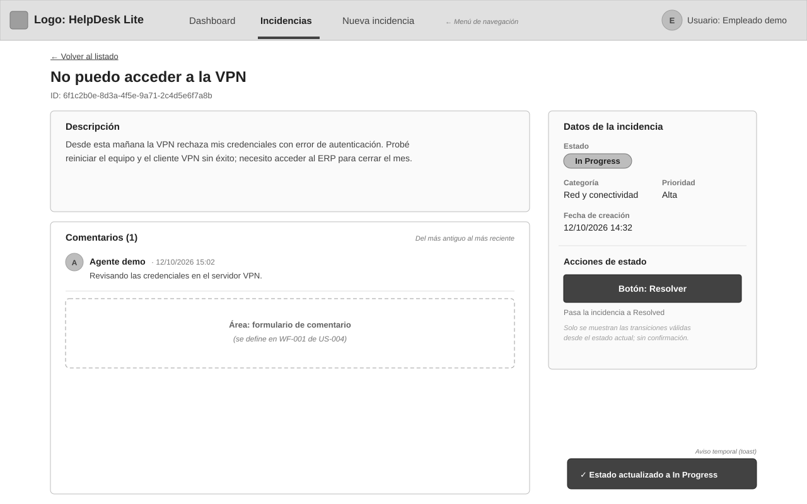
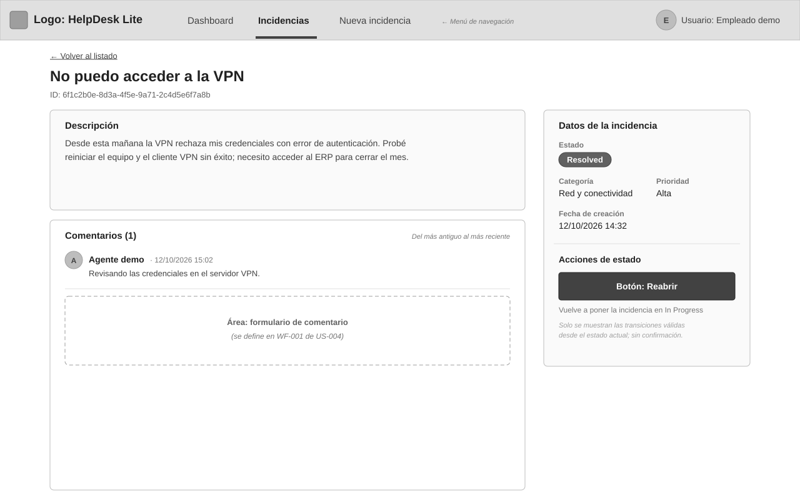
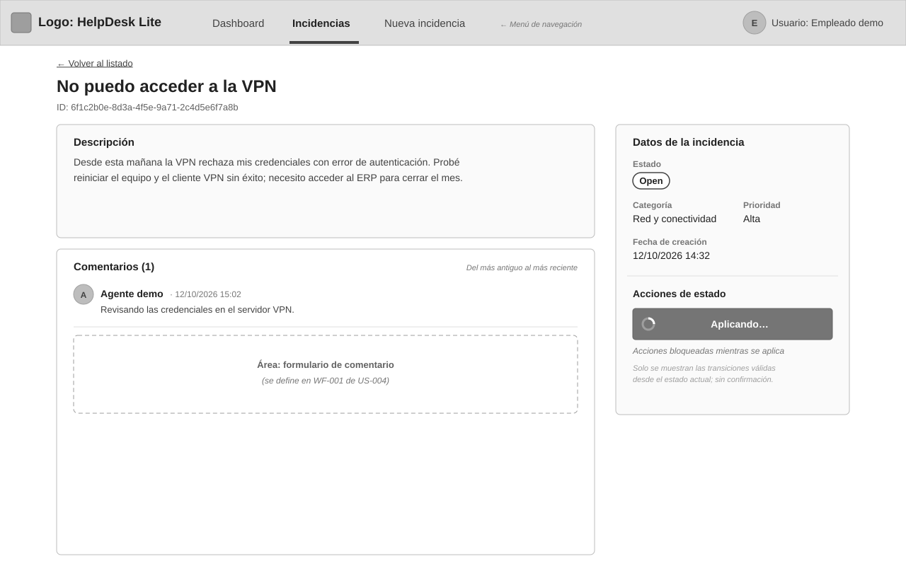
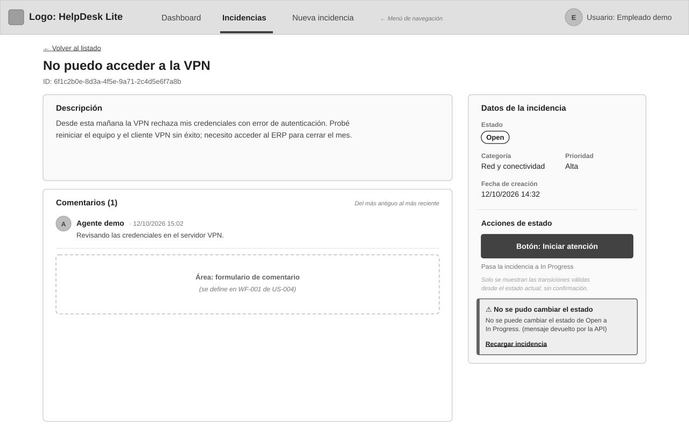

# WF-001: Acciones de estado

<!-- wireframe:status=Approved -->
**Estado:** Approved
**Tipo de solución:** Aplicación web (Angular) — responsiva
**Origen:** [US-005: Cambiar el estado de una incidencia](../README.md)
**Requisitos relacionados:** AC-001, AC-002, AC-003, AC-005, AC-006, AC-007, AC-008, AC-009

En el panel lateral del detalle, el agente ve solo la acción válida desde el estado actual — `Open` → «Iniciar atención», `In Progress` → «Resolver», `Resolved` → «Reabrir» — y la aplica sin confirmación (AC-001, AC-002, AC-007). Mientras se aplica, la acción muestra carga y queda bloqueada; al terminar, el detalle muestra el nuevo estado (AC-005, AC-006); si falla o la transición es rechazada, aparece un error comprensible y se conserva el estado anterior (AC-003, AC-008, AC-009).

## Wireframe

## Componentes

- Pantalla de detalle de [WF-001 de US-003](../../US-003-detalle-incidencia/wireframes/WF-001-detalle-incidencia.md); esta pantalla define solo la sección «Acciones de estado» del panel «Datos de la incidencia».
- Etiqueta de estado actual en el panel (literal `Open` / `In Progress` / `Resolved`).
- Un único botón primario con la transición válida y un texto debajo que indica el estado destino:
  - `Open`: «Iniciar atención» → `In Progress`.
  - `In Progress`: «Resolver» → `Resolved`.
  - `Resolved`: «Reabrir» → `In Progress`.
- Sin diálogo de confirmación: pulsar el botón aplica la transición (AC-007).

## Estados

- En atención (resultado de «Iniciar atención»): la etiqueta pasa a `In Progress`, el botón cambia a «Resolver» y aparece un aviso temporal «Estado actualizado a In Progress» (AC-005, AC-007) — [WF-001-acciones-estado-en-atencion.svg](./WF-001-acciones-estado-en-atencion.svg)

  

- Resuelta: etiqueta `Resolved` y botón «Reabrir» (AC-007) — [WF-001-acciones-estado-resuelta.svg](./WF-001-acciones-estado-resuelta.svg)

  

- Aplicando: el botón muestra un indicador y «Aplicando…», y queda deshabilitado; el estado mostrado no cambia hasta la respuesta (AC-008) — [WF-001-acciones-estado-aplicando.svg](./WF-001-acciones-estado-aplicando.svg)

  

- Error (fallo o transición rechazada): alerta «No se pudo cambiar el estado» con el mensaje de la API (p. ej. «No se puede cambiar el estado de Open a In Progress») y el enlace «Recargar incidencia»; la etiqueta conserva el estado anterior y el botón vuelve a habilitarse (AC-003, AC-008, AC-009) — [WF-001-acciones-estado-error.svg](./WF-001-acciones-estado-error.svg)

  

## Notas

- Contrato: `PATCH /incidents/{id}/status` ([API-001](../../../../../architecture/incidencias/apis/API-001-incidencias.md#patch-incidents-id-status)) con body `{ status }`; el `200` devuelve la incidencia actualizada y un `409` indica transición no permitida, cuyo `message` en español se muestra tal cual (AC-009). Transiciones según [DG-001](../../../../../architecture/incidencias/diagrams/DG-001-estados-incidencia.md).
- Propuesta: tras un rechazo (`409`), lo más probable es que el estado haya cambiado en otra sesión; por eso la alerta ofrece «Recargar incidencia» para traer el estado vigente y sus acciones válidas.
- Propuesta: aviso temporal (toast) de éxito «Estado actualizado a …», que desaparece solo.
- El nuevo estado se refleja en el listado al volver a consultarlo ([WF-001 de US-002](../../US-002-listar-filtrar-incidencias/wireframes/WF-001-listado-incidencias.md)) (AC-006).
- Vista móvil: el botón de la acción va a ancho completo bajo los datos de la incidencia (ver [vista móvil de WF-001 de US-003](../../US-003-detalle-incidencia/wireframes/WF-001-detalle-incidencia-movil.svg)).

## Historial de cambios

| Fecha | Observación del usuario | Resuelto en |
| ----- | ------------------------- | ------------ |
| 2026-10-12 | Aprobado tal cual en la revisión del lote | — |
