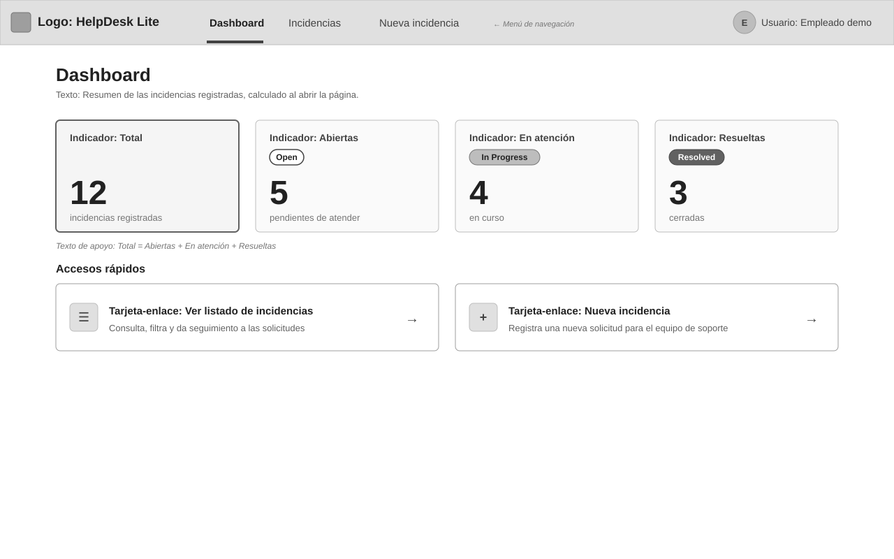
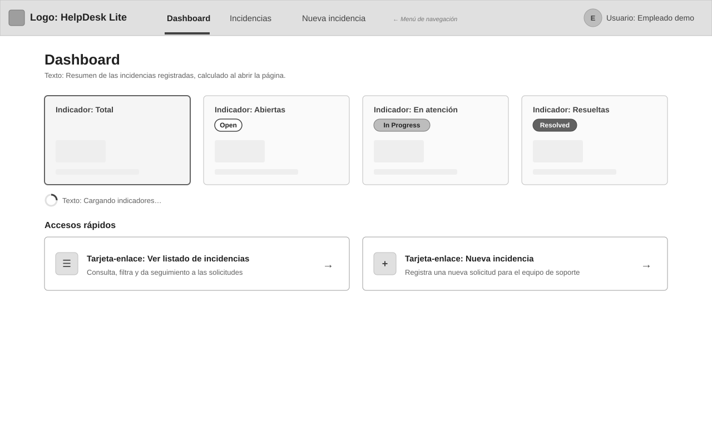
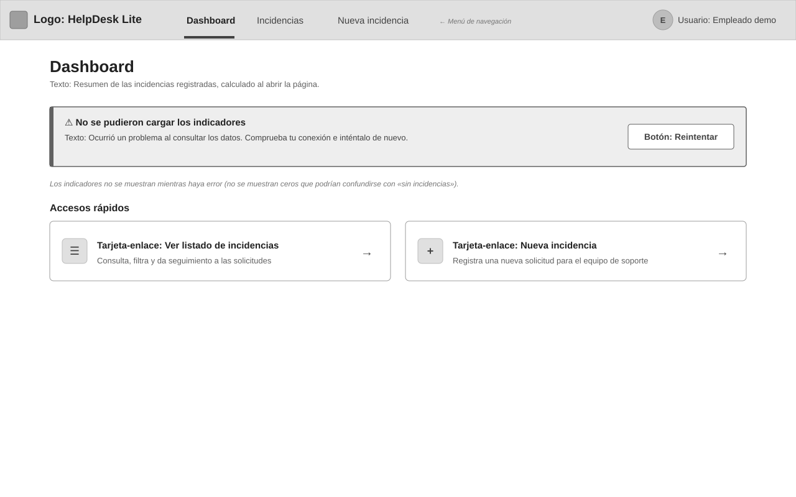
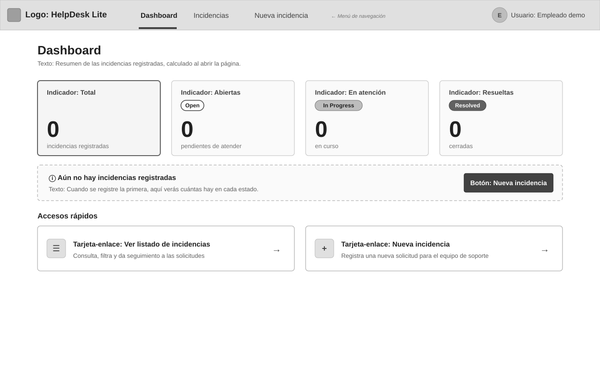
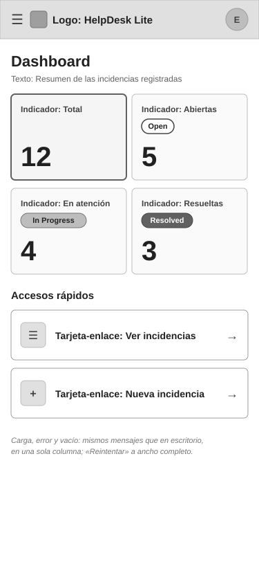

# WF-001: Dashboard

<!-- wireframe:status=Approved -->
**Estado:** Approved
**Tipo de solución:** Aplicación web (Angular) — responsiva
**Origen:** [US-006: Consultar el dashboard de indicadores](../README.md)
**Requisitos relacionados:** AC-001, AC-002, AC-003, AC-004, AC-005, AC-006, AC-007, AC-008, AC-009

Página principal de la aplicación (AC-006): el responsable de soporte ve, al abrirla, el total de incidencias y cuántas hay abiertas, en atención y resueltas, calculadas en ese momento (AC-001 a AC-004), sin gráficos ni comparaciones (AC-007). Desde ella accede al listado y al registro de una incidencia nueva (AC-006). Muestra carga, error con reintentar (AC-008) y un estado sin incidencias con los cuatro indicadores en cero y un mensaje explicativo (AC-005).

## Wireframe

## Componentes

- Encabezado: logo/nombre «HelpDesk Lite», menú de navegación (Dashboard · Incidencias · Nueva incidencia, con la sección activa marcada) y el usuario de la demo («Empleado demo»).
- Título «Dashboard» y texto breve que indica que los datos se calculan al abrir la página (AC-004).
- Cuatro tarjetas de indicador, de igual tamaño, en una fila (AC-002):
  - «Total» (tarjeta destacada) — incidencias registradas.
  - «Abiertas» con la etiqueta de estado `Open`.
  - «En atención» con la etiqueta de estado `In Progress`.
  - «Resueltas» con la etiqueta de estado `Resolved`.
- Texto de apoyo «Total = Abiertas + En atención + Resueltas» (AC-003).
- Accesos rápidos: tarjeta-enlace «Ver listado de incidencias» (abre el listado, [WF-001 de US-002](../../US-002-listar-filtrar-incidencias/wireframes/WF-001-listado-incidencias.md)) y tarjeta-enlace «Nueva incidencia» (abre el registro, [WF-001 de US-001](../../US-001-registrar-incidencia/wireframes/WF-001-registro-incidencia.md)) (AC-006).

## Estados

- Cargando: las tarjetas muestran su título y un bloque gris en lugar del número, con el texto «Cargando indicadores…»; los accesos rápidos siguen disponibles (AC-008) — [WF-001-dashboard-cargando.svg](./WF-001-dashboard-cargando.svg)

  

- Error: alerta «No se pudieron cargar los indicadores» con un motivo comprensible y el botón «Reintentar»; las tarjetas no se muestran para no confundir el error con «cero incidencias»; los accesos rápidos siguen disponibles (AC-008) — [WF-001-dashboard-error.svg](./WF-001-dashboard-error.svg)

  

- Sin incidencias: las cuatro tarjetas en `0` y el mensaje «Aún no hay incidencias registradas» con el botón «Nueva incidencia» (AC-005) — [WF-001-dashboard-vacio.svg](./WF-001-dashboard-vacio.svg)

  

- Vista móvil (responsiva): tarjetas en cuadrícula de 2 × 2, accesos rápidos apilados a ancho completo y menú de navegación tras el icono ☰; mismos estados de carga, error y vacío en una sola columna — [WF-001-dashboard-movil.svg](./WF-001-dashboard-movil.svg)

  

## Notas

- Los números son de ejemplo. Los valores provienen de `GET /incidents/summary` ([API-001](../../../../../architecture/incidencias/apis/API-001-incidencias.md#get-incidents-summary), [MD-003](../../../../../architecture/incidencias/models/MD-003-indicadores-incidencias.md)): `total`, `open`, `inProgress`, `resolved` ↔ Total, Abiertas, En atención, Resueltas (AC-009).
- Propuesta: las tarjetas de indicador son solo informativas (no enlazan al listado filtrado por estado); el acceso al listado es la tarjeta-enlace y el menú. Sin botón «Actualizar»: los datos se recalculan al volver a abrir la página (la actualización en tiempo real está fuera de alcance).
- Propuesta: el menú de navegación del encabezado es común a todas las pantallas (Dashboard, listado, detalle); el WF-001 aprobado de US-001 no lo dibuja, pero no cambia su contenido.
- La ruta raíz de la aplicación abre este dashboard (AC-006); la dirección exacta se fija en la planificación técnica.

## Historial de cambios

| Fecha | Observación del usuario | Resuelto en |
| ----- | ------------------------- | ------------ |
| 2026-10-12 | Aprobado tal cual en la revisión del lote | — |
